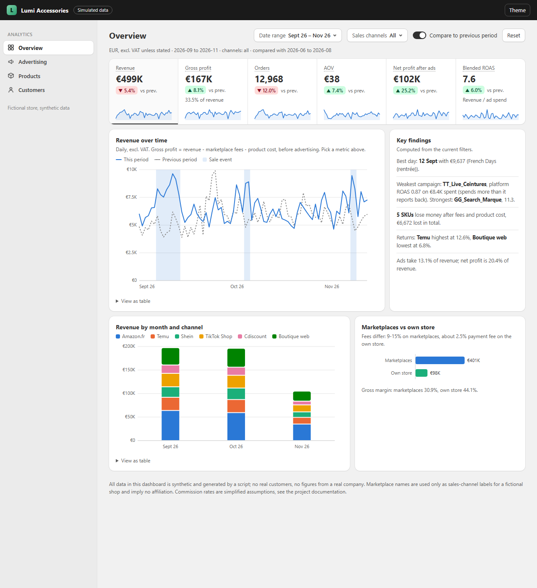

# Lumi Accessories: e-commerce analytics dashboard (France, simulated data)

An end-to-end analytics project on a **fictional** French fashion-accessories store that sells on Amazon.fr, Temu, Shein, TikTok Shop, Cdiscount and its own web shop, and advertises on Meta, TikTok and Google.

Everything is generated by script, loaded into a **MySQL star schema**, and explored in an **interactive single-file HTML dashboard** (no server, no external libraries). A Power BI model specification is included in `docs/`.

> **All data is synthetic.** There are no real customers and no figures from a real company. Marketplace names are only sales-channel labels for a fictional shop and imply no affiliation. Several patterns (loss-making SKUs, a loss-making campaign, over-reporting by one ad platform, high return rates on some categories) were **planted on purpose** to exercise the analysis, so they are not findings about the real market.

**Live demo:** https://corgi-coder99.github.io/Lumi-Ecommerce-Dashboard/ (single-file dashboard, works on phone and desktop)



## What it answers

| Page | Questions |
|---|---|
| Overview | How much revenue and profit, and how do sale events (Prime Day, French Days, soldes, Singles Day) move them? Marketplace vs own store? |
| Advertising | Which campaigns lose money? How far apart are platform-reported ROAS and blended ROAS? CAC, CPO, CTR |
| Products | Which categories and SKUs make or lose money after fees and cost? Return rate by category and channel |
| Customers | New customers per month, cohort retention, repeat rate, AOV by channel, revenue by region |

Filters: month range and sales channel. Light and dark themes. Every chart has a hover tooltip, and the main charts have a "View as table" fallback.


## Pipeline

```
generate_data.py          6 order exports + 3 ad exports + products, fees, calendar (CSV, one schema per source)
        |
build_dw.py               staging tables -> cleaning -> star schema in MySQL 8.4 (lumi_dw) + quality checks
        |
dashboard/export_dashboard_data.py   aggregates only (no customer-level rows) -> data.json
dashboard/build.py        template.html + data.json -> site/index.html (self-contained)
```

Star schema: `fact_order_line`, `fact_ads_daily`; dimensions `dim_date`, `dim_product`, `dim_platform`, `dim_platform_fee`, `dim_campaign`, `dim_customer`; views `v_sales_daily`, `v_sku_profit`, `v_campaign_perf`.

## Design decisions worth knowing

- **VAT.** French shelf prices include 20% VAT. Revenue is analysed excl. VAT (`net_ht = net_ttc / 1.2`); product cost and ad spend are excl. VAT; marketplace commission is applied to the VAT-inclusive price.
- **Messy sources on purpose.** Each channel exports different column names, timestamp formats (ISO, epoch seconds, epoch milliseconds, `dd/mm/YYYY`), decimal commas, and status vocabularies. TikTok Shop has exact duplicate rows, Cdiscount has missing regions. The loader normalises all of it and checks row counts per channel.
- **Time zone.** All timestamps are treated as UTC and converted to Paris time with an explicit summer/winter rule, not MySQL time-zone tables, so results are reproducible on any machine.
- **Two ROAS numbers.** Ad platforms report their own attributed value (including VAT). The dashboard shows that next to *blended ROAS* (revenue excl. VAT / all ad spend), and hides net profit, blended ROAS and CIR when only some sales channels are selected, because ads are not attributable to a sales channel in this data.
- **Reconciliation.** Dashboard totals were checked against SQL on the warehouse: revenue, orders, gross profit, units, ad spend and customer count match exactly.
- **What I chose not to scrape.** Real marketplaces were not scraped: it is against their terms, and listings on leboncoin, Vinted or Facebook Marketplace contain personal data. Fee schedules and the sales calendar come from public pages and are documented, with a confidence level for each, in `docs/market-fr/sources.md`.

## Run it

**Option A, no database needed (DuckDB):**

```bash
pip install duckdb
python generate_data.py --out data/raw_fr                      # synthetic CSVs (seed 42)
python build_dw_duckdb.py --raw data/raw_fr                    # staging -> star schema -> quality checks (about 2 s)
python dashboard/export_dashboard_data.py --engine duckdb --db data/lumi.duckdb
python dashboard/build.py                                      # -> site/index.html
python tests/test_duckdb_parity.py                             # known totals must match to the cent
```

**Option B, MySQL 8.4** (the original warehouse, also used by the Power BI model): `pip install pymysql`, create database `lumi_dw` and a user, export `MYSQL_PWD` (nothing stores a password), then `python build_dw.py --raw data/raw_fr` and `python dashboard/export_dashboard_data.py`.

Open `site/index.html` in any browser. It works offline.

## What else is in the repo

| Folder | Contents |
|---|---|
| `sql/` | 8 analysis queries (CTEs, window functions): KPIs, SKU profit, campaign ROAS, event uplift, cohort retention, RFM, repeat rate, returns. Results reconciled with the dashboard. |
| `docs/erd.md`, `docs/data-dictionary.md` | Entity-relationship diagram (Mermaid) and a column-level dictionary with units (EUR, excl./incl. VAT, UTC/Paris) |
| `powerbi/` | DAX measures, a step-by-step Power BI Desktop setup and an **untested** TMDL semantic model (see `powerbi/README.md` for status) |
| `tests/` | DuckDB build checked against the MySQL build (0 differing rows, known totals to the cent) |

Related project on **real** data: [Online-Retail-Insights](https://github.com/Corgi-coder99/Online-Retail-Insights) (UCI Online Retail II: cleaning log, RFM, cohorts, backtested forecasts, auto-generated insights).

## Limitations

- Commission rates are simplified fixed percentages (Amazon.fr really uses price bands), see `docs/market-fr/sources.md` for the sources and confidence.
- Orders are not linked to campaigns, so CAC is a blended figure and ROAS by channel is platform-reported.
- Customer identity is a hash that matches across channels, which real data rarely allows.
- The first cohort months are partly incomplete (data ends on 15 Nov 2026).

## Documentation

`docs/00-requirements-filtered.md` (project scope), `docs/10-dashboard-spec.md` (Power BI model and DAX measures), `docs/assumptions-log.md` (13 numbered assumptions), `docs/market-fr/sources.md` (public sources, confidence levels).

## Résumé en français

Projet d'analyse e-commerce sur une boutique **fictive** d'accessoires de mode en France (Amazon.fr, Temu, Shein, TikTok Shop, Cdiscount, boutique en ligne ; publicité Meta, TikTok, Google). Les données sont **synthétiques**, générées par script ; les tendances (références déficitaires, campagne déficitaire, sur-déclaration d'une plateforme publicitaire) ont été injectées volontairement pour tester l'analyse et ne sont pas des constats sur le marché réel. Le pipeline charge des exports hétérogènes dans un schéma en étoile (MySQL ou DuckDB), gère la TVA (prix TTC, CA analysé HT) et l'heure de Paris, rapproche les lignes par canal, puis alimente un tableau de bord HTML autonome (`site/index.html`). Aucune marketplace n'a été scrapée. Pour une analyse sur données réelles, voir [Online-Retail-Insights](https://github.com/Corgi-coder99/Online-Retail-Insights).

## License

MIT, see `LICENSE`.
