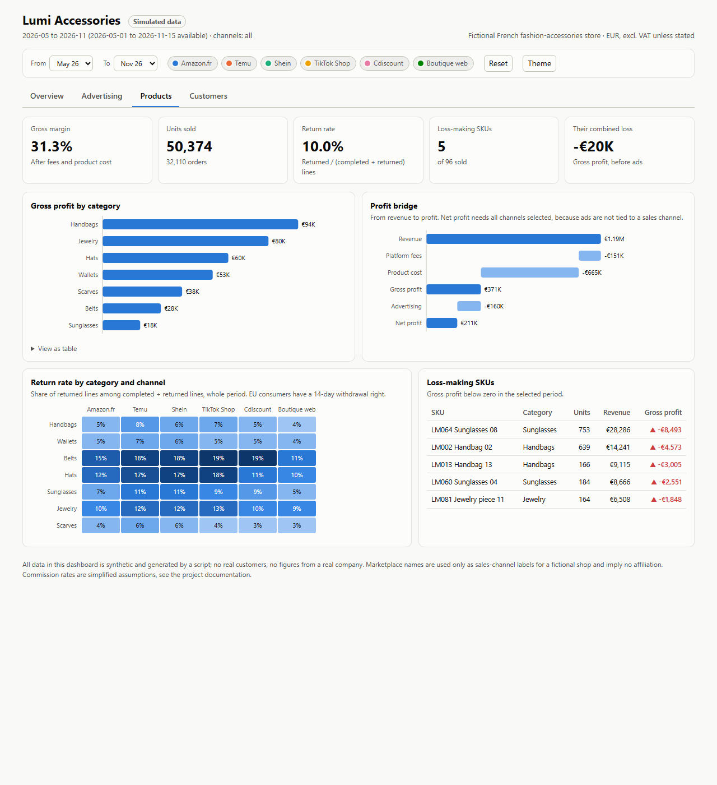

# Lumi Accessories: e-commerce analytics dashboard (France, simulated data)

An end-to-end analytics project on a **fictional** French fashion-accessories store that sells on Amazon.fr, Temu, Shein, TikTok Shop, Cdiscount and its own web shop, and advertises on Meta, TikTok and Google.

Everything is generated by script, loaded into a **MySQL star schema**, and explored in an **interactive single-file HTML dashboard** (no server, no external libraries). A Power BI model specification is included in `docs/`.

> **All data is synthetic.** There are no real customers and no figures from a real company. Marketplace names are only sales-channel labels for a fictional shop and imply no affiliation. Several patterns (loss-making SKUs, a loss-making campaign, over-reporting by one ad platform, high return rates on some categories) were **planted on purpose** to exercise the analysis, so they are not findings about the real market.


## What it answers

| Page | Questions |
|---|---|
| Overview | How much revenue and profit, and how do sale events (Prime Day, French Days, soldes, Singles Day) move them? Marketplace vs own store? |
| Advertising | Which campaigns lose money? How far apart are platform-reported ROAS and blended ROAS? CAC, CPO, CTR |
| Products | Which categories and SKUs make or lose money after fees and cost? Return rate by category and channel |
| Customers | New customers per month, cohort retention, repeat rate, AOV by channel, revenue by region |

Filters: month range and sales channel. Light and dark themes. Every chart has a hover tooltip, and the main charts have a "View as table" fallback.



## Pipeline

```
generate_data.py          6 order exports + 3 ad exports + products, fees, calendar (CSV, one schema per source)
        |
build_dw.py               staging tables -> cleaning -> star schema in MySQL 8.4 (lumi_dw) + quality checks
        |
dashboard/export_dashboard_data.py   aggregates only (no customer-level rows) -> data.json
dashboard/build.py        template.html + data.json -> site/index.html (self-contained)
```

Star schema: `fact_order_line`, `fact_ads_daily`; dimensions `dim_date`, `dim_product`, `dim_platform`, `dim_platform_fee`, `dim_campaign`, `dim_customer`; views `v_sales_daily`, `v_sku_profit`, `v_campaign_perf`.

## Design decisions worth knowing

- **VAT.** French shelf prices include 20% VAT. Revenue is analysed excl. VAT (`net_ht = net_ttc / 1.2`); product cost and ad spend are excl. VAT; marketplace commission is applied to the VAT-inclusive price.
- **Messy sources on purpose.** Each channel exports different column names, timestamp formats (ISO, epoch seconds, epoch milliseconds, `dd/mm/YYYY`), decimal commas, and status vocabularies. TikTok Shop has exact duplicate rows, Cdiscount has missing regions. The loader normalises all of it and checks row counts per channel.
- **Time zone.** All timestamps are treated as UTC and converted to Paris time with an explicit summer/winter rule, not MySQL time-zone tables, so results are reproducible on any machine.
- **Two ROAS numbers.** Ad platforms report their own attributed value (including VAT). The dashboard shows that next to *blended ROAS* (revenue excl. VAT / all ad spend), and hides net profit, blended ROAS and CIR when only some sales channels are selected, because ads are not attributable to a sales channel in this data.
- **Reconciliation.** Dashboard totals were checked against SQL on the warehouse: revenue, orders, gross profit, units, ad spend and customer count match exactly.
- **What I chose not to scrape.** Real marketplaces were not scraped: it is against their terms, and listings on leboncoin, Vinted or Facebook Marketplace contain personal data. Fee schedules and the sales calendar come from public pages and are documented, with a confidence level for each, in `docs/market-fr/sources.md`.

## Run it

Requirements: Python 3.12+, MySQL 8.4, `pip install pymysql`.

```bash
python generate_data.py --out data/raw_fr          # synthetic CSVs
# create database lumi_dw and a user, then export MYSQL_PWD (the script never stores a password)
python build_dw.py --raw data/raw_fr               # load, clean, model, run checks
python dashboard/export_dashboard_data.py          # aggregates -> dashboard/data.json
python dashboard/build.py                          # -> site/index.html
```

Open `site/index.html` in any browser. It works offline.

## Limitations

- Commission rates are simplified fixed percentages (Amazon.fr really uses price bands), see `docs/market-fr/sources.md` for the sources and confidence.
- Orders are not linked to campaigns, so CAC is a blended figure and ROAS by channel is platform-reported.
- Customer identity is a hash that matches across channels, which real data rarely allows.
- The first cohort months are partly incomplete (data ends on 15 Nov 2026).

## Documentation

`docs/00-requirements-filtered.md` (project scope), `docs/10-dashboard-spec.md` (Power BI model and DAX measures), `docs/assumptions-log.md` (13 numbered assumptions), `docs/market-fr/sources.md` (public sources, confidence levels).
