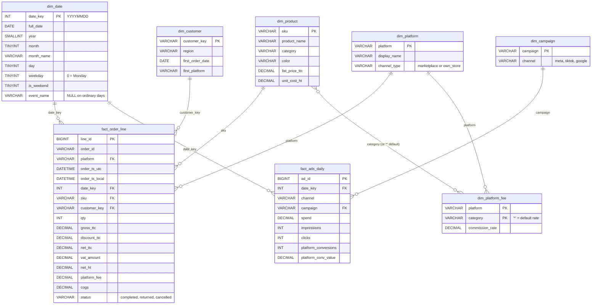

# Entity-relationship diagram: `lumi_dw`

Star schema in MySQL 8.4, built by `build_dw.py`. Two fact tables (`fact_order_line`, `fact_ads_daily`) share the date dimension. Column types are those of the DDL in `build_dw.py`. Column meanings are in [data-dictionary.md](data-dictionary.md).

MySQL does not declare foreign keys in this warehouse (the loader guarantees integrity and checks it), so the relationships below are logical joins. The join key is shown on each line.

## Relationships

| From (many) | To (one) | Join key | Notes |
|---|---|---|---|
| `fact_order_line` | `dim_date` | `date_key` | Local (Paris) calendar day of the order |
| `fact_order_line` | `dim_product` | `sku` | |
| `fact_order_line` | `dim_platform` | `platform` | Sales channel |
| `fact_order_line` | `dim_customer` | `customer_key` | Hash that matches across channels |
| `fact_ads_daily` | `dim_date` | `date_key` | |
| `fact_ads_daily` | `dim_campaign` | `campaign` | `fact_ads_daily.channel` repeats `dim_campaign.channel` |
| `dim_platform_fee` | `dim_platform` | `platform` | One row per platform and category |
| `dim_platform_fee` | `dim_product` | `category` | Category-specific rate if present, else the `'*'` row. Used only while loading `fact_order_line` |

There is no join between `fact_order_line` and `fact_ads_daily`: orders are not attributed to campaigns (assumption A7). Compare them only through shared dimensions such as `dim_date`.

Views built on top: `v_sales_daily`, `v_sku_profit`, `v_campaign_perf` (see the data dictionary).
